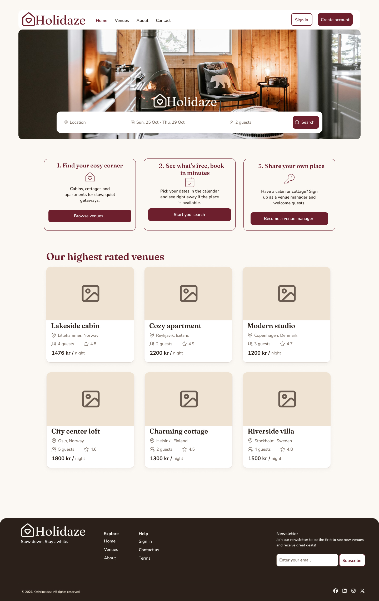

# Holidaze



## Intro

Holidaze is an online booking website where the user can book a cozy stay at a cabin or a warm and exotic place.

Holidaze is my project exam 2 and is a part of my studies to become a front-end developer.

#### Live Demo: [SageShop][sageshop]

[//]: # 'Source definitions'
[sageshop]: https://sageshop.netlify.app/ 'SageShop'

## Feature overview

- Browse venues
- User can log in or registrer an account
- Sort venues by options
- Search venues
- View venue as guest
- View venue as a user
  - Book a venue
- View venue as a venue manager
  - View upcoming stays at your venue
  - Edit or delete your venue
- Profile page
  - View account
    - Update your bio and/or profile picture
  - View my bookings
    - Edit or cancel your booking
  - View my venues
  - View upcoming stays at your venues
- Contact form with form validation
- Booking confirmation
- Breadcrumb on pages
- Responsive design for all devices

## Contents

- [Getting started](#getting-started)
  - [Requirements](#requirements)
  - [Install](#install)
  - [Usage](#usage)
- [Used Technologies](#used-technologies)
  - [Technical Choices](#technical-choices)
  - [API](#api)
- [Images](#images-and-project-structure)
- [Contributing](#contributing)
  - [Testing](#testing)
- [Further Improvements](#further-improvements)
- [Author](#author)

## Getting Started

In order to run this project locally on your computer, you have to do the following steps.
It is easier than you think.

### Requirements

Make sure that you have the following installed on your computer:

- Node.js (version 20.19 or higher)
- npm
- Git

### Install

#### 1. Clone the repository:

Use git to clone this repository into your computer. Assuming using https, then run the following in your CLI:

```
git clone https://github.com/Kateve52911/holidaze.git
```

#### 2. Install dependencies:

Navigate to the root directory of the repo and run the following to install all dependencies.

```
npm install
```

### Usage

To run the development server:

```bash
npm run dev
```

Open your browser and navigate to the local host address shown in the terminal.

To build the project for production:

```bash
npm run build
```

And then run the following command to view it:

```
npm run preview
```

Open your browser and navigate to the local host address shown in the terminal.

## Used technologies

The tech stack for this project includes:

- React
- TypeScript
- Tailwind CSS
  - Shadcn/ui
  - Lucide Icons
- TanStack Router
- TanStack Query
- React Hook Form
- Zod
- Vite
- Vitest
- Husky
- ESLint
- Prettier
- Lint-staged

### Technical choices

**TanStack Query:** caches the products, so going back to the homepage doesn’t fetch them again.

**Search in URL:** it is shareable and it survives a refresh

**Filter → sort → paginate:** the product list goes through three steps, in this order:

1. **Filter:** only products that match the search
2. **Sort:** by the chosen sort option
3. **Paginate:** only the products for the current page

The order matters: if the list was paginated before sorting, "lowest price"
would only sort the 9 products on the current page, not all of them.

### API

Product data comes from the [Noroff Holidaze API](https://docs.noroff.dev/docs/v2/holidaze/bookings).

## Images and Project structure

### Images

The index page on a computer:


## Contributing

To contribute to the project, simply install as detailed above, and then after finishing your changes, create a PR on GitHub.

### Testing

This project includes unit tests to test the sorting, form validation and the cart store.

To run tests and to keep watch for changes, run the following command:

```
npm test
```

To run all tests once, run the following command:

```
npm run test:run
```

## Author

Kathrine Mellem Evensen

[My portfolio website](https://kathrine-dev.vercel.app)

[My Github Profile](https://github.com/Kateve52911)

[My LinkedIn page](https://www.linkedin.com/in/kathrine-mellem-evensen-6855b612b)
